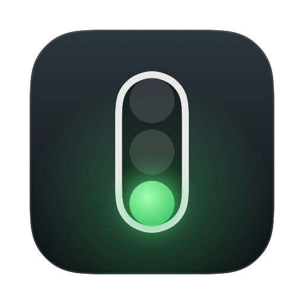
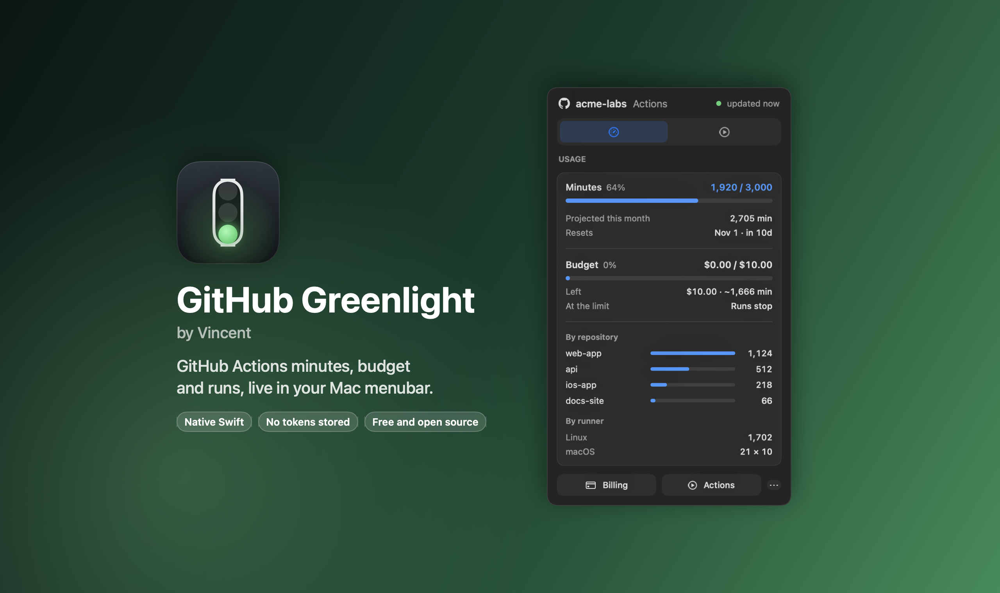
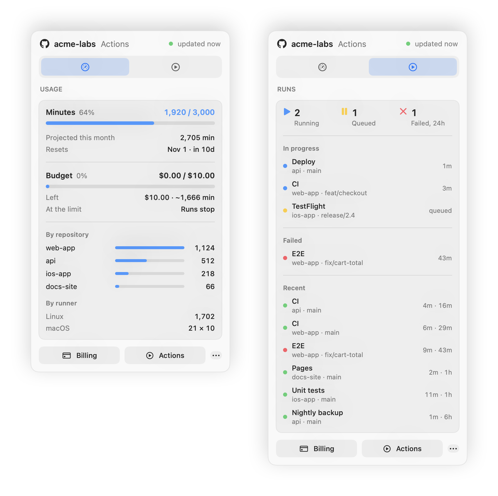
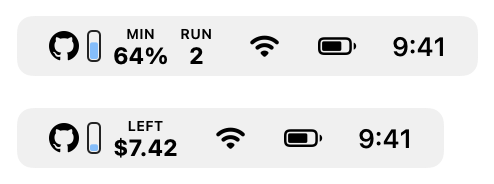
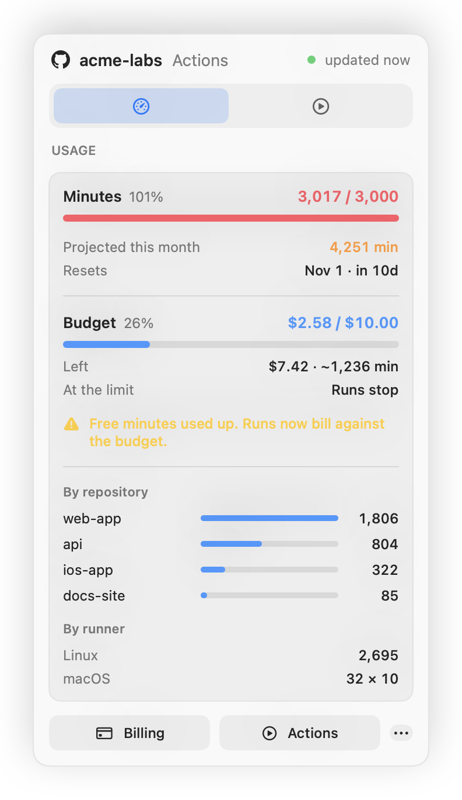
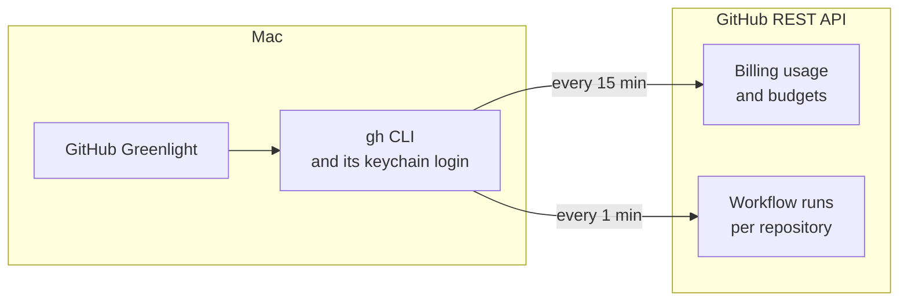

<div align="center">



# GitHub Greenlight

**GitHub Actions minutes, budget and workflow runs, live in your macOS menu bar.**

Know how many included minutes are left, what your spending limit still covers,<br>
and which workflows are running right now, without opening the billing page.

[](#requirements)
[](Sources/Greenlight)
[](#how-it-works)
[](#privacy-and-permissions)
[](LICENSE)

[Get started](#get-started) ·
[Features](#features) ·
[How it works](#how-it-works) ·
[FAQ](#faq)

<br>



</div>

## Why GitHub Greenlight

GitHub Actions bills by the minute. Every plan includes a monthly allowance (2,000 minutes on Free, 3,000 on Pro and Team) and after that you pay, up to the budget you set. The problem: you only find out where you stand by digging through **Settings → Billing**, usually after the minutes are gone and your CI has stopped.

GitHub Greenlight puts that number where you already look all day. A small gauge in the menu bar fills as you use your included minutes. When they run out, it switches to the dollars left in your budget. Click it for the full picture: usage per repository, what is running, what failed, and when the meter resets.

- **Glanceable.** A GitHub mark, a gauge and one number, drawn to sit next to the system icons in light and dark mode.
- **Budget-aware.** Reads the Actions budget you set on GitHub and shows what it still buys, in dollars and in minutes.
- **Live runs.** Running and queued workflows refresh every minute. Re-run failed jobs or cancel a run from the menu.
- **Calm.** Failures live in the popover, never in the menu bar. It tells you what is happening without nagging.
- **No tokens stored.** It uses the GitHub CLI you are already logged in to. Nothing to paste, nothing saved on disk.
- **Native and light.** One small Swift binary. No Electron, no web views, no background daemon.

## Features

<picture>
  <source media="(prefers-color-scheme: dark)" srcset="docs/images/tabs-dark.png">
  
</picture>

| Tab | What you see |
|---|---|
| **Usage** | Included minutes used this month, projected total, reset date, your Actions budget with dollars and minutes left, minutes per repository, minutes per runner with the macOS and Windows multipliers |
| **Runs** | Running, queued and failed counts, every in-progress run, failures from the last 24 hours, the latest finished runs with duration. Click to open on GitHub, right-click to re-run failed jobs, cancel or copy the link |

### The menu bar follows your month

<picture>
  <source media="(prefers-color-scheme: dark)" srcset="docs/images/menubar-dark.png">
  
</picture>

| State | Menu bar shows |
|---|---|
| Within your included minutes | `MIN 64%` and a gauge that turns orange at 70% and red at 90% |
| Included minutes used up, budget set | `LEFT $7.42` and a gauge of the budget spent |
| A workflow is running | `RUN 2` next to the number |
| Signed out or offline | The GitHub mark alone, tinted |

### When the free minutes run out

<picture>
  <source media="(prefers-color-scheme: dark)" srcset="docs/images/budget-dark.png">
  
</picture>

GitHub Greenlight reads your Actions budget and whether it stops usage at the limit, then tells you plainly which world you are in: billing against the budget, or blocked until the reset.

## Get started

### Let your AI agent do it

<p>
  
  
  
  
  
</p>

Paste this into any agent that can run commands on your Mac:

```text
Install GitHub Greenlight, a macOS menu bar app for GitHub Actions usage, from
https://github.com/vincent-caetano/Github-Greenlight-by-Vincent
Clone it, run scripts/build-app.sh --install, and make sure `gh auth status` is logged in.
Never ask me for tokens in chat: give me the command to run myself.
```

### Or set it up yourself

**1. Install and log in to the GitHub CLI** (skip if `gh auth status` already says you are logged in)

```bash
brew install gh
gh auth login
```

**2. Build and install GitHub Greenlight.** You need the Xcode command line tools (`xcode-select --install`).

```bash
git clone https://github.com/vincent-caetano/Github-Greenlight-by-Vincent.git
cd Github-Greenlight-by-Vincent
scripts/build-app.sh --install
```

That builds a universal app (Apple silicon and Intel), copies it to `~/Applications` and opens it.

**3. Pick your account.** GitHub Greenlight starts with your first organization, or your personal account if you have none. Switch any time from the `···` menu under **Account**.

> [!TIP]
> On recent macOS versions, new menu bar items can be hidden. If you do not see it, open **System Settings → Menu Bar** and turn on **GitHub Greenlight** under *Allow in the Menu Bar*.

## How it works



GitHub Greenlight runs `gh api` with the login you already have. It never sees or stores a token.

| Every | What | Endpoint |
|---|---|---|
| 1 minute | Running, queued, failed and recent runs, for repositories pushed in the last 30 days | `GET /repos/{owner}/{repo}/actions/runs` |
| 15 minutes | Minutes and dollars used this month, per repository and runner | `GET /organizations/{org}/settings/billing/usage` (or `/users/{user}/…`) |
| 15 minutes | Your Actions budget and whether it stops usage | `GET /organizations/{org}/settings/billing/budgets` |
| 1 hour | Which repositories to watch | `GET /orgs/{org}/repos` |

GitHub itself refreshes billing usage about once an hour, so asking more often would not show anything new. Run status is the part that changes by the minute, so that is what refreshes by the minute.

**Rate limits:** a typical account with five active repositories makes about 6 calls a minute, a little over 350 an hour, well under the 5,000 an hour GitHub allows a logged-in user.

### Included minutes and multipliers

| Runner | One minute costs | Plan | Included minutes per month |
|---|---|---|---|
| Linux | 1 included minute | Free | 2,000 |
| Windows | 2 included minutes | Pro, Team | 3,000 |
| macOS | 10 included minutes | Enterprise | 50,000 |

The plan is read from your account. On a custom deal, set the number yourself:

```bash
defaults write io.github.vincent-caetano.greenlight includedMinutes -int 3000
```

### Privacy and permissions

- GitHub Greenlight only reads, except when you click **Re-run failed jobs** or **Cancel run**.
- The only connections it makes are to the GitHub API, through `gh`. No analytics, no update pings, no accounts.
- It remembers one thing: which account you picked, in your Mac's user defaults.
- Billing data needs you to be an **owner or billing manager** of the organization. Without that, the Runs tab still works.

## Requirements

- macOS 14 Sonoma or later, on Apple silicon or Intel
- [GitHub CLI](https://cli.github.com) (`gh`), logged in
- A GitHub account or organization on the enhanced billing platform, which is every account today

## FAQ

<details>
<summary><b>Does it cost anything?</b></summary>

No. GitHub Greenlight is free and open source, and API calls do not use Actions minutes or appear on your bill.
</details>

<details>
<summary><b>Why does it say it cannot read billing?</b></summary>

Organization billing is only visible to owners and billing managers. Ask an owner to add you as a billing manager, or switch to your personal account from the <code>···</code> menu.
</details>

<details>
<summary><b>My runs fail in a few seconds. Is that the budget?</b></summary>

Possibly. When included minutes are gone and the budget is at its limit with <i>stop usage</i> on, GitHub stops new jobs at once. The Usage tab says <b>Budget reached</b> in red when that is the case. If it does not, the failure has another cause: open the run from the Runs tab to see its log.
</details>

<details>
<summary><b>Does it support GitHub Enterprise Server?</b></summary>

Not yet. It talks to github.com through <code>gh</code>. Pull requests are welcome.
</details>

<details>
<summary><b>How do I start it at login?</b></summary>

Open the <code>···</code> menu and turn on <b>Open at login</b>.
</details>

<details>
<summary><b>How do I remove it?</b></summary>

Quit it from the <code>···</code> menu and drag GitHub Greenlight.app to the Trash. To clear its settings too: <code>defaults delete io.github.vincent-caetano.greenlight</code>.
</details>

## Roadmap

- [ ] Notifications at 80% and 100% of included minutes, and when a budget is reached
- [ ] Several accounts at once
- [ ] Packages, Codespaces and Copilot usage
- [ ] Homebrew cask
- [ ] Signed and notarized releases

Ideas and pull requests are welcome.

## Contributing

```bash
swift build                              # compile
swift run Greenlight --demo              # run with made-up data, no GitHub calls
scripts/screenshots.sh                   # regenerate the README images and the icon
scripts/build-app.sh --zip               # build a release zip
```

| File | What it does |
|---|---|
| [`API.swift`](Sources/Greenlight/API.swift) | Every GitHub endpoint it calls, and the `gh` wrapper |
| [`Model.swift`](Sources/Greenlight/Model.swift) | Refresh timing, usage math and run grouping |
| [`Views.swift`](Sources/Greenlight/Views.swift) | The popover and its two tabs |
| [`Icons.swift`](Sources/Greenlight/Icons.swift) | The menu bar gauge, the GitHub mark and the app icon |
| [`Demo.swift`](Sources/Greenlight/Demo.swift) | Made-up data for the demo and the screenshots |

## Related

**[Hostbar](https://github.com/vincent-caetano/hostbar)**, the same idea for your Linux server: CPU, memory and disk in the menu bar over SSH.

## License

[MIT](LICENSE) © 2026 Vincent Caetano

GitHub and the GitHub logo are trademarks of GitHub, Inc. This project is independent and is not affiliated with or endorsed by GitHub.
